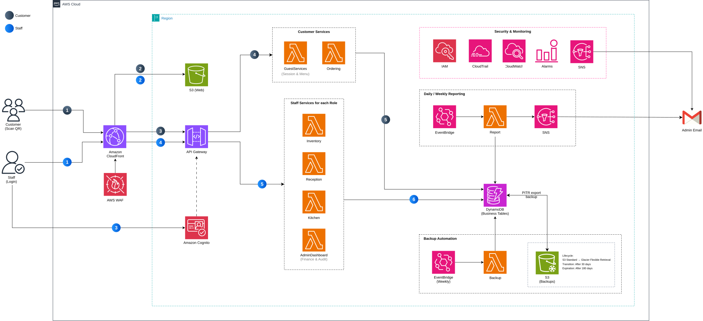

# SecureTable – Restaurant Management System on AWS

## Hệ thống quản lý nguyên liệu và gọi món bằng mã QR trên nền tảng AWS Serverless

---

### 1. Tổng quan dự án

**SecureTable** là hệ thống quản lý nhà hàng quy mô nhỏ, tập trung vào việc gọi món, quản lý nguyên liệu, hóa đơn và theo dõi doanh thu. Khách hàng quét mã QR cố định tại bàn để xem thực đơn và đặt món; nhân viên sử dụng các giao diện riêng để xử lý nghiệp vụ.

Hệ thống hướng đến mô hình **Serverless** trên AWS nhằm giảm công việc vận hành máy chủ và thuận tiện cho việc mở rộng. Dự án được triển khai thử nghiệm tại **AWS Region Asia Pacific (Singapore) – `ap-southeast-1`**.

**Nhóm người dùng:**

- **Guest:** Quét QR, xem thực đơn, gọi món không cần tài khoản.
- **Reception:** Quản lý bàn, mở và đóng hóa đơn.
- **Kitchen:** Xác nhận hoàn tất hoặc từ chối món.
- **Inventory:** Nhập kho, cập nhật và điều chỉnh nguyên liệu.
- **Admin:** Xem báo cáo tài chính và lịch sử thao tác.

### 2. Mục tiêu dự án

- Xây dựng website quản lý nhà hàng hoạt động trên AWS.
- Đồng bộ dữ liệu giữa đặt món, bếp, kho và hóa đơn.
- Theo dõi nguyên liệu nhập, đặt giữ, tiêu thụ và thất thoát.
- Phân quyền nhân viên; ghi nhận các thao tác quan trọng để truy vết.
- Tự động hóa báo cáo, sao lưu và giám sát hệ thống.
- Áp dụng các nguyên tắc **AWS Well-Architected** về bảo mật, độ tin cậy, hiệu năng, vận hành và chi phí.

### 3. Vấn đề cần giải quyết

Ở nhiều quán ăn nhỏ, việc ghi chép nguyên liệu, tiếp nhận đơn hàng và tổng hợp doanh thu còn phụ thuộc vào sổ sách hoặc công cụ riêng lẻ. Điều này dễ gây sai lệch tồn kho, chậm truyền đơn đến bếp và khó kiểm tra các thay đổi dữ liệu.

**Giải pháp:** SecureTable sử dụng một hệ thống dữ liệu tập trung. Khi khách đặt món, thông tin được gửi đến bếp và liên kết với lượng nguyên liệu đặt giữ. Khi món được xử lý và hóa đơn được đóng, dữ liệu tồn kho và tài chính được cập nhật theo quy tắc nghiệp vụ. Người quản lý có thể tra cứu báo cáo và Audit Logs thay vì đối chiếu thủ công.

### 4. Kiến trúc giải pháp

| Dịch vụ AWS | Vai trò |
|---|---|
| **Amazon S3 + Amazon CloudFront** | Lưu trữ và phân phối giao diện web qua HTTPS. |
| **Amazon API Gateway** | Tiếp nhận và định tuyến yêu cầu API. |
| **AWS Lambda** | Xử lý GuestServices, Ordering, Reception, Kitchen, Inventory, AdminDashboard, Report và Backup. |
| **Amazon DynamoDB** | Lưu trữ bàn, bill, đơn hàng, nguyên liệu, tài chính và audit. |
| **Amazon Cognito + AWS IAM** | Xác thực nhân viên và giới hạn quyền truy cập tài nguyên. |
| **Amazon EventBridge Scheduler + Amazon SNS** | Lập lịch báo cáo, backup và gửi thông báo email. |
| **Amazon CloudWatch + AWS CloudTrail** | Giám sát, cảnh báo và theo dõi hoạt động trên AWS. |
| **AWS WAF** | Lọc một số loại request web bất thường (nếu được bật trong bản triển khai). |

**Các luồng chính:**

1. **Guest:** Quét QR → CloudFront → API Gateway → GuestServices/Ordering → DynamoDB. Guest Session chỉ hợp lệ khi bill tương ứng đang mở.
2. **Staff:** Đăng nhập qua Cognito → gọi API Gateway → Lambda theo nghiệp vụ → DynamoDB.
3. **Kitchen/Inventory:** Xử lý món hoặc nguyên liệu; cập nhật dữ liệu bằng các điều kiện và transaction khi cần duy trì tính nhất quán.
4. **Automation:** EventBridge Scheduler → Report/Backup Lambda → SNS hoặc xuất dữ liệu DynamoDB sang S3.

**Định hướng Well-Architected:** Dùng IAM theo quyền tối thiểu, HTTPS và Cognito cho bảo mật; DynamoDB Transactions và backup cho độ tin cậy; CloudWatch cho vận hành; Lambda và DynamoDB cho khả năng mở rộng theo nhu cầu; theo dõi sử dụng tài nguyên để tối ưu chi phí.

### 5. Lộ trình triển khai

| Giai đoạn | Nội dung |
|---|---|
| **Tuần 1–2** | Phân tích yêu cầu, thiết kế kiến trúc và dữ liệu DynamoDB. |
| **Tuần 3–4** | Triển khai frontend S3/CloudFront, Cognito, API Gateway và các Lambda chính. |
| **Tuần 5–6** | Hoàn thiện Ordering, Kitchen, Inventory, Reception, Finance/Audit và báo cáo. |
| **Tuần 7–8** | Bổ sung monitoring, bảo mật, backup; kiểm thử và chuẩn bị demo, tài liệu Workshop. |

### 6. Ngân sách dự kiến

**Kịch bản ước tính:** Nhà hàng 10 bàn, khoảng 20–30 hóa đơn/ngày, 40.000 API request/tháng và khoảng 1 GB dữ liệu DynamoDB; chạy tại Singapore.

| Nhóm chi phí | Cách kiểm soát |
|---|---|
| **CloudFront, S3** | Dùng frontend tĩnh và theo dõi lưu lượng truyền tải. |
| **API Gateway, Lambda** | Trả phí theo mức sử dụng; điều chỉnh memory/timeout dựa trên CloudWatch. |
| **DynamoDB** | Chọn capacity mode phù hợp; hạn chế Scan không cần thiết. |
| **CloudWatch, SNS, EventBridge** | Giới hạn thời gian lưu logs và tần suất tác vụ. |
| **WAF, PITR, S3 backup** | Chỉ bật cấu hình cần thiết và giám sát chi phí lưu trữ. |

**Ngân sách sơ bộ:** khoảng **10–30 USD/tháng** cho môi trường thử nghiệm lưu lượng thấp. Đây là khoảng dự trù, **chưa phải kết quả chính thức từ AWS Pricing Calculator**; cần đối chiếu cấu hình thực tế, chính sách giá WAF/CloudFront, Free Tier và phí backup trước khi nộp.

Tham khảo: [AWS Pricing Calculator](https://calculator.aws/).

### 7. Rủi ro và biện pháp giảm thiểu

| Rủi ro | Hướng xử lý |
|---|---|
| QR tĩnh bị sao chép và dùng để đặt món từ xa | Giới hạn session theo bill đang mở; Reception kiểm tra đơn tranh chấp. Xác thực bổ sung là hướng phát triển tiếp theo. |
| Đặt món đồng thời gây sai lệch tồn kho | Dùng DynamoDB Transactions, điều kiện cập nhật và idempotency cho thao tác quan trọng. |
| Lambda/API lỗi hoặc timeout | Theo dõi CloudWatch, cảnh báo và cho phép thử lại các tác vụ được thiết kế an toàn. |
| Rò rỉ quyền truy cập | Cognito cho nhân viên, IAM theo quyền tối thiểu và kiểm tra quyền tại backend. |
| Mất dữ liệu hoặc vượt ngân sách | Sao lưu định kỳ, thử khôi phục; dùng AWS Budgets và rà soát tài nguyên. |

### 8. Kết quả kỳ vọng

SecureTable hướng tới một **MVP có thể demo trọn vẹn** quy trình: Reception mở bàn → khách quét QR và gọi món → Kitchen xử lý → Inventory cập nhật nguyên liệu → Reception đóng bill → Admin xem báo cáo và lịch sử thao tác.

Về kỹ thuật, dự án cần chứng minh các AWS service phối hợp đúng theo sơ đồ, dữ liệu nghiệp vụ được cập nhật nhất quán, có kiểm soát truy cập, monitoring, báo cáo và sao lưu. Về lâu dài, hệ thống có thể mở rộng thêm thanh toán trực tuyến, nhiều chi nhánh và cơ chế xác minh QR chặt chẽ hơn.
